# Tracelight

**A fast, open viewer for GPU timelines: NVIDIA Nsight Systems reports and
PyTorch profiler traces, on the desktop, in the browser, or headless.**

Tracelight opens `.nsys-rep` reports without needing `nsys` installed, as
well as `nsys` SQLite exports and PyTorch profiler traces. It puts the ranks
of a distributed job side by side on one time axis, lined up on their NCCL
collectives, and stays smooth on traces with millions of events. It is
written in pure Go (no cgo) on the [MyGo](https://github.com/egoist/mygo) UI
framework. The same code draws the desktop app, the browser app and
headless PNGs.


- [Features](#features)
- [Quick start](#quick-start)
- [The desktop app](#the-desktop-app)
- [Many ranks: sessions and the rank overview](#many-ranks-sessions-and-the-rank-overview)
- [PyTorch profiler traces](#pytorch-profiler-traces)
- [Server mode and the browser apps](#server-mode-and-the-browser-apps)
- [traceshot: timeline screenshots from the command line (and for agents)](#traceshot-timeline-screenshots-from-the-command-line-and-for-agents)
- [Headless rendering, info and benchmarks](#headless-rendering-info-and-benchmarks)
- [Keyboard and mouse](#keyboard-and-mouse)
- [How it stays fast](#how-it-stays-fast)
- [Development](#development)
- [Limitations](#limitations)
- [License](#license)

## Features

- **Reads the formats you have.**
  - Nsight Systems reports (`.nsys-rep`, `.qdrep`): decoded natively for
    the report versions it verifies. For other versions it converts with
    `nsys export` when `nsys` is available.
  - SQLite exports (`nsys export --type sqlite`).
  - PyTorch profiler / Kineto Chrome traces (`.json`, `.json.gz`), with
    Python stacks. These can be one file per rank, or several ranks merged
    into one file.
- **A timeline built for GPU work.**
  - Rows by GPU and CUDA stream (kernels, memcpy, memset), and by process
    and thread (NVTX ranges, Python calls, CPU operators, CUDA API calls).
  - A thread's rows are ordered as its stack, outermost first.
  - Kernels are colored by name, in three shades so that neighbors stand
    apart, and named wherever they fit.
- **Smooth navigation.**
  - Zoom around the pointer (touchpad pinch, Ctrl/⌘ + wheel or keys), pan, and hold W/A/S/D.
  - Measure a range (Shift + drag).
  - Hover tooltips, and click to select.
- **Details and links.**
  - Launch configuration, sizes and throughput.
  - The CUDA API call that launched a kernel, with a flow line and
    **Go to launch** (and back).
  - The Python stack and operator stack that a piece of GPU work was
    launched from.
- **Summaries.**
  - Top kernels, CUDA API calls, NVTX ranges and CPU ops, with count,
    average, min, max and share.
  - Computed over the whole trace or over a measured range, with events
    clipped to it.
  - Click a summary row to highlight its events.
- **Many ranks.**
  - Open a folder, a glob, or a merged file. The ranks line up on the ends
    of their collective kernels to within microseconds, or on their clocks.
  - Pick which ranks show.
  - A compact **rank overview** makes stragglers and idle GPUs stand out.
- **Anywhere.**
  - A native desktop app (Linux, macOS).
  - `tracelight serve`, which parses traces on the GPU machine and streams
    them to a browser or to the desktop app as tiles.
  - Two browser clients, including the desktop UI compiled to WebAssembly.
- **Headless.**
  - `--screenshot` and `--info` for CI.
  - `traceshot`, a small static CLI that renders a window of several ranks
    into a PNG. It comes with a skill file for coding agents.
- **Light and dark** appearances, following the system or chosen by you.

## Quick start

Prebuilt downloads are on the repository's Releases page: the macOS app
(Apple silicon), Linux tarballs and `.deb`s (x86-64, arm64), and traceshot,
with their SHA-256 checksums. To build from source, you need Go 1.27 or
later. Everything builds with `CGO_ENABLED=0`.

```sh
git clone <this repository> tracelight && cd tracelight
go build -o tracelight .

go run ./cmd/gensample               # a synthetic nsys trace: samples/sample.sqlite (~200k events)
./tracelight samples/sample.sqlite
```

The samples are generated, not committed. The generators are deterministic
and take about a second:

```sh
go run ./cmd/gensample -ranks 8                      # an 8-rank job, one .sqlite per rank: samples/ranks/
go run ./cmd/gensample -ranks 16 -o samples/ranks16  # 16 ranks
go run ./cmd/gentorch -ranks 4 -o samples/torch      # a 4-rank PyTorch job (-merged: one file; -gz; -no-stack)
```

To open your own traces:

```sh
nsys profile -o myrun python train.py
./tracelight myrun.nsys-rep            # read natively: no nsys needed to view it
./tracelight runs/job42/               # a folder of ranks, side by side
./tracelight trace.pt.trace.json.gz    # a PyTorch profiler trace
```

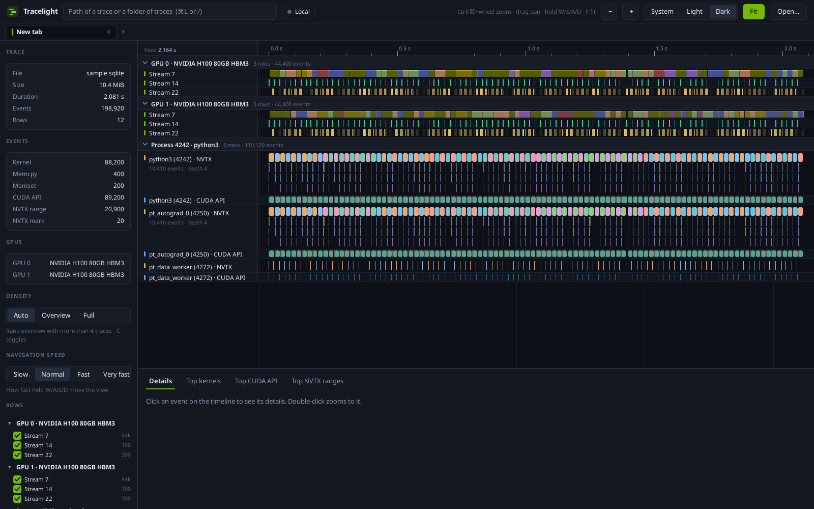

## The desktop app

### Linux

The window uses GTK 3 and OpenGL, loaded at run time without cgo. Install
`libgtk-3-0` and `libepoxy0`; any desktop that runs GTK apps already has
them. Without a usable GPU (in a VM, or under Xvfb), MyGo draws on the CPU.

### macOS (Apple silicon)

`go build` and run, as on Linux. The window draws with Metal. Because MyGo
needs no cgo, you can also cross-compile from any machine, without Xcode:

```sh
CGO_ENABLED=0 GOOS=darwin GOARCH=arm64 go build -o tracelight-macos-arm64 .
go tool mygo build -platform darwin/arm64      # build/darwin-arm64/Tracelight.app (+ a .dmg when run on a Mac)
go tool mygo build -platform darwin/universal  # Apple silicon and Intel in one app
```

`go tool mygo build` (MyGo's CLI, pinned in `go.mod` as a tool) reads
`mygo.json`. For `-platform linux/amd64` it writes a Linux binary, a
`.deb`, a tarball and an install script. Disk images, signing and
notarization need a Mac; see MyGo's
[distribution guide](https://github.com/egoist/mygo/blob/main/docs/distribution.md).
An unsigned app copied from elsewhere may need these commands first:

```sh
xattr -dr com.apple.quarantine Tracelight.app     # if it was downloaded
codesign --force --deep -s - Tracelight.app       # an ad-hoc signature, if macOS refuses to start it
open Tracelight.app --args /path/to/trace.nsys-rep
```

### Opening traces

You do everything from the window:

- **The path box** (Ctrl/⌘+L or `/`) takes several kinds of input, and
  suggests recent paths and the entries of the folder you type:
  - the path of a trace;
  - a folder (every trace in it, in natural order: rank2 before rank10);
  - a glob (`/runs/job7/rank[0-3].sqlite`);
  - a brace pattern, as a shell's: `/runs/job7/rank{0,3,5}.sqlite`, or a
    range, `/runs/job7/rank{0..15}.nsys-rep` (`{00..15}` zero-pads);
  - one rank of a merged file (`job.json.gz#rank8`, or
    `job.json.gz#rank{0,8}`);
  - several of these, separated by spaces.
- **Loading** several traces shows a line for each one, with how far it
  has got (reading, building, done, or why it failed), and a bar for all of
  them together. This works for files on this machine and on a server.
- **Other ways in:** the Open dialog (Ctrl/⌘+O), dropping files on the
  window, or the file manager (the app registers `.nsys-rep`).
- **Tabs:** each tab keeps a trace or a session open, with its own view,
  selection and folded rows, so switching tabs reloads nothing.
  Ctrl/⌘+T opens a tab and Ctrl/⌘+W closes it. Ctrl/⌘+Enter in the path box
  opens the path in a new tab.

For a report of a version the native decoder doesn't verify, Tracelight
runs `nsys export --type sqlite` when `nsys` is on the `PATH` (or in
`$NSYS`). It keeps the export next to the report, or in the user cache
directory, and reuses it while it is at least as new as the report.
`TRACELIGHT_NATIVE=off` always uses nsys; `=force` tries the native decoder
on any version. The supported versions and the format are documented in
[FORMAT_NOTES.md](FORMAT_NOTES.md).

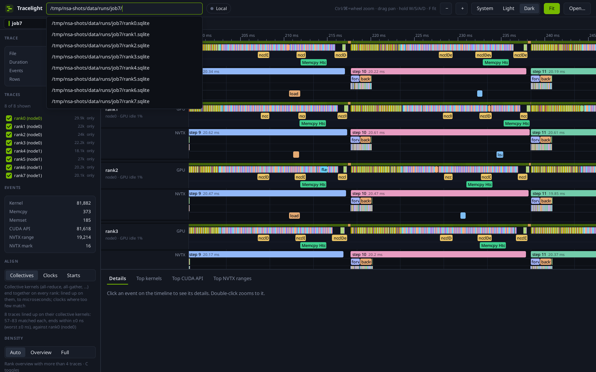

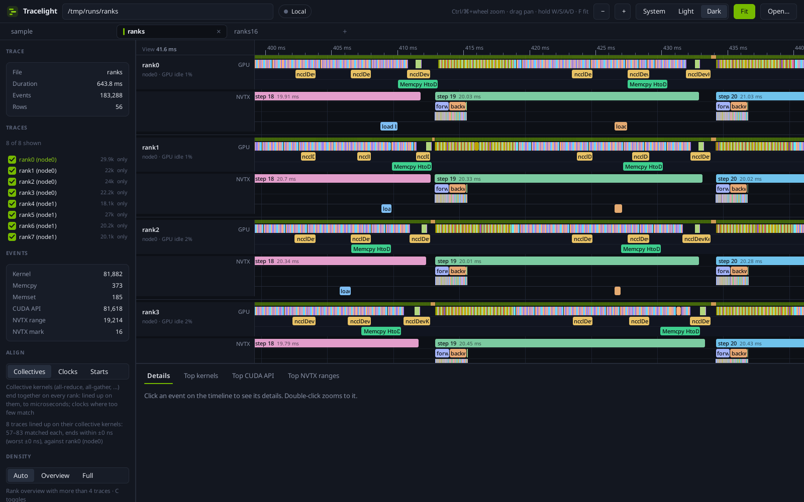

## Many ranks: sessions and the rank overview

A folder, a glob, several paths or a merged PyTorch file opens as a
**session**: the traces stack on one time axis, each under a heading with
its name, host and rank. Zoom, pan, measuring and selection apply to all
of them.

**Alignment.** Hosts' clocks agree to milliseconds at best, so by default
(**Collectives**) Tracelight lines the ranks up on their NCCL collective
kernels (all-reduce, all-gather, reduce-scatter, broadcast, all-to-all),
which end at the same moment on every rank. Each trace is moved until its
collectives' ends meet those of a reference trace, refined down to 200 µs
windows; the sidebar shows how many matched and how close they are.

- **Clocks** places each trace by its capture's wall clock (or its host's
  monotonic clock).
- **Starts** puts every first event at 0.

On a real four-node job, the ends of the all-reduces seen by every rank
were these distances apart:

| Aligned on | Median distance between all-reduce ends |
|---|---|
| Starts | 488 ms |
| The hosts' clocks | 2.6 ms |
| The collectives | 7 µs (57 µs p90) |

**Choosing which ranks show.**
- Untick a trace in the sidebar's list to leave it out; **only** (or
  Alt/⌥-click) shows it alone.
- To open only some ranks, name them: `rank{0..3}.sqlite`, or
  `rank{0,7,15}.nsys-rep`.
- The file browsers let you pick several traces to open side by side.
- Links keep the choice (`#only=rank0,rank8`).

**The rank overview.** It turns on by itself with more than four traces;
**C** toggles it. Each rank becomes a compact block of:
- a GPU busy/idle strip, with idle gaps tinted, so a rank that starts
  late, waits or straggles stands out;
- one summary lane per kind of row (GPU and NVTX by default; CUDA API,
  CPU ops and Python on request).

Work that runs in parallel (compute beside NCCL, copies beside kernels)
gets sub-lanes of its own. Streams that never overlap share one, so idle
streams take no room.


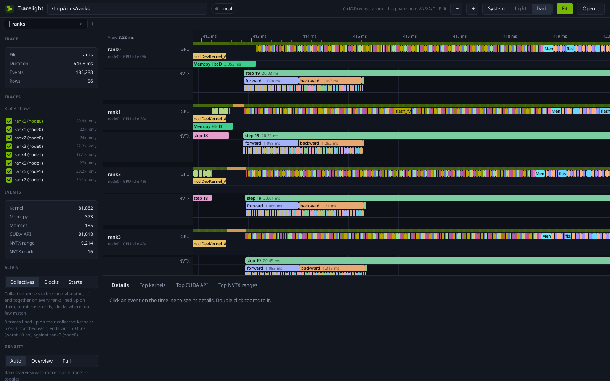

| Picking traces to open | A session, 3 of 8 ranks shown |
|---|---|
| 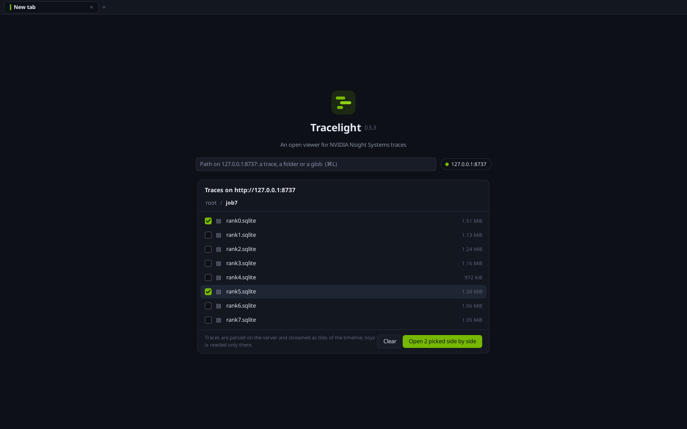 | 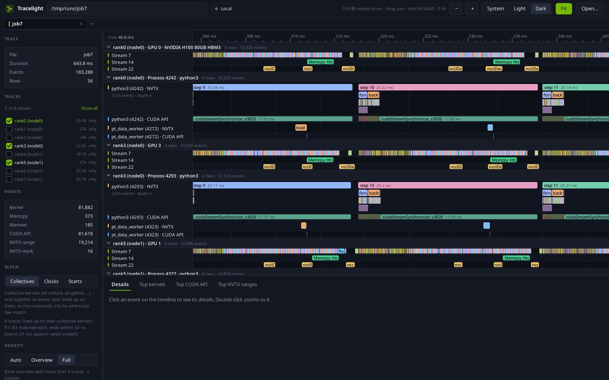 |

## PyTorch profiler traces

Tracelight opens what `torch.profiler` writes through Kineto: the
Chrome-trace JSON of `prof.export_chrome_trace(...)` or of
`tensorboard_trace_handler(dir)` (`*.pt.trace.json`), plain or gzipped.
Files are recognized by their content, so a `config.json` beside them is
left alone.

```python
with torch.profiler.profile(
    activities=[ProfilerActivity.CPU, ProfilerActivity.CUDA],
    record_shapes=True, with_stack=True,      # with_stack: the Python stacks
    schedule=torch.profiler.schedule(wait=1, warmup=1, active=3),
    on_trace_ready=torch.profiler.tensorboard_trace_handler("./runs/job"),
) as prof:
    for step, batch in enumerate(loader):
        train_step(batch)
        prof.step()
```

Each Kineto category becomes a kind of row:

| Kineto category | Shown as |
|---|---|
| `kernel`, `gpu_memcpy`, `gpu_memset` | GPU work, on its device's streams |
| `cuda_runtime`, `cuda_driver` | a thread's **CUDA API** row, linked to the GPU work by correlation id |
| `cpu_op` | a thread's **CPU ops** row (`aten::` ops, autograd functions), nested |
| `python_function` (`with_stack=True`) | a thread's **Python** row: a flame chart, one lane per stack depth |
| `user_annotation` | a thread's **Annotations** row: `record_function` ranges and `ProfilerStep#N` |

- **Python stacks.** Select any event to see the Python stack it ran
  under, innermost frame first, with your own frames in bold. For a kernel
  or a copy, the stack is that of the CUDA call that launched it: the line
  of your model that put the work on the GPU.
- **Operator stacks.** The details also list the operators and annotations
  an event ran under (for example `aten::linear › aten::addmm` for a GEMM).
  This is useful when you profiled without `with_stack`.
- **Ranks.** A folder of per-rank files (`torchrun` with
  `tensorboard_trace_handler`) opens as a session, ranked by each trace's
  `distributedInfo`. So does a single file of several ranks merged, as
  merge tools write it, with processes named after their ranks
  (`rank8:4127`). Each rank becomes its own trace, `file.json.gz#rank8`.

Other Chrome traces open too: their spans (`X`, or `B`/`E`) become
operators of their threads.

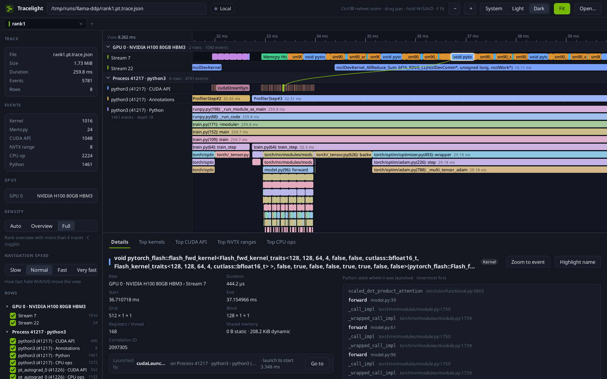

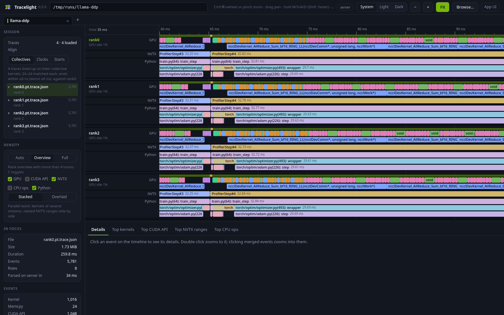

## Server mode and the browser apps

Profiles usually live on the GPU machine. `tracelight serve` runs there
headless: it parses traces where they are, and streams them as tiles of
the timeline to a browser or to the desktop app. Neither nsys nor the
trace files are ever needed on your laptop.

```sh
tracelight serve --root /data/profiles --addr :8737 --token auto
# tracelight: open http://gpu-server.example.com:8737/#token=3f9c…
```

**From a browser**, open the printed URL. Type a path in the path box, or
browse. Links open traces directly: `/?path=/abs/run.sqlite#token=…`. They
can repeat `path=` for a session, and they keep the view, the selection and
the alignment (`#v=start,end&sel=…&align=start`). There are two clients:

- **Classic** (the default at `/`): a small JavaScript client (about
  0.25 MB) drawing on a 2D canvas. It stays smooth even without GPU
  acceleration.
- **App UI** (beta, at `/app.html`, or at `/` with `serve --ui wasm`): the
  desktop app itself, compiled to WebAssembly, with its tabs, rank overview
  and keys. It is a 5.2 MB download, once per version.

**From the desktop app**, connect from the window (**Connect to server…**,
Ctrl/⌘+K) or from the command line. Any URL copied from a browser works,
including links to traces. **Download for offline** fetches the whole
parsed trace, so you can keep viewing it without the server.

```sh
tracelight --server http://gpu-server.example.com:8737 --token 3f9c…       # pick a trace in the window
tracelight --server http://gpu-server.example.com:8737 runs/train.sqlite   # or open one directly
```

**Behind a gateway.** The server works behind a reverse proxy, under any
path prefix. If the gateway signs browsers in (single sign-on), paste its
address into the desktop app: the app opens the sign-in page in a window,
then keeps the session cookie for that server (in a settings file readable
only by you) until it expires.

**Security.**
- Every path a client sends must resolve inside `--root`, with symbolic
  links followed.
- With `--token` (or `$TRACELIGHT_TOKEN`), every API request needs
  `Authorization: Bearer <token>`. Tokens are never accepted in query
  strings.
- The server listens on 127.0.0.1 unless `--addr` says otherwise, and warns
  if it listens more widely without a token.
- It speaks plain HTTP: across untrusted networks, use a TLS proxy or
  `ssh -L 8737:localhost:8737 gpu-server`.

**API** (all `GET`, JSON unless noted):

| Endpoint | What it returns |
|---|---|
| `/api/info` | the server's information |
| `/api/files?dir=` | a directory listing |
| `/api/session?path=` | the traces that paths, folders, globs and brace patterns name |
| `/api/progress?path=` | how far the server's load of each trace named has got (phase and fraction), for loading screens |
| `/api/trace?path=` | a trace's rows and metadata |
| `/api/tile?path=&level=&index=` | a tile of the timeline |
| `/api/summary?path=&kind=&n=[&from=&to=]` | the top kernels, API calls or ranges, optionally over a range |
| `/api/event?path=&row=&lane=&index=` | an event's details and the event correlated with it |
| `/api/snapshot?path=` | the whole parsed trace (binary) |

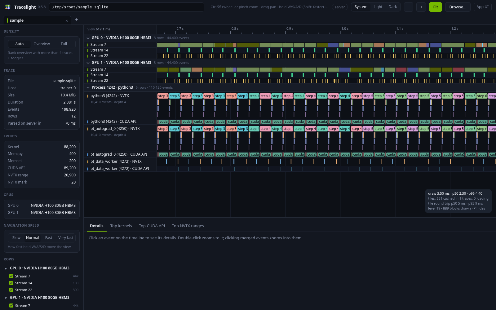

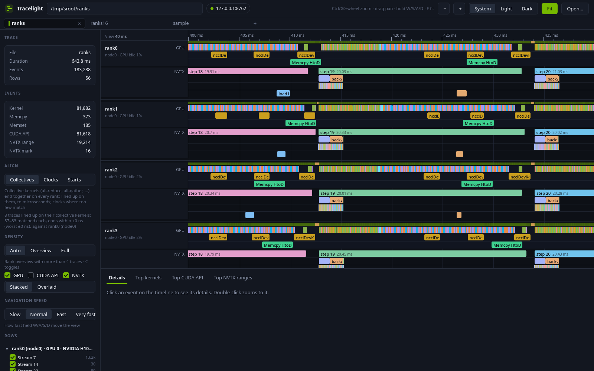

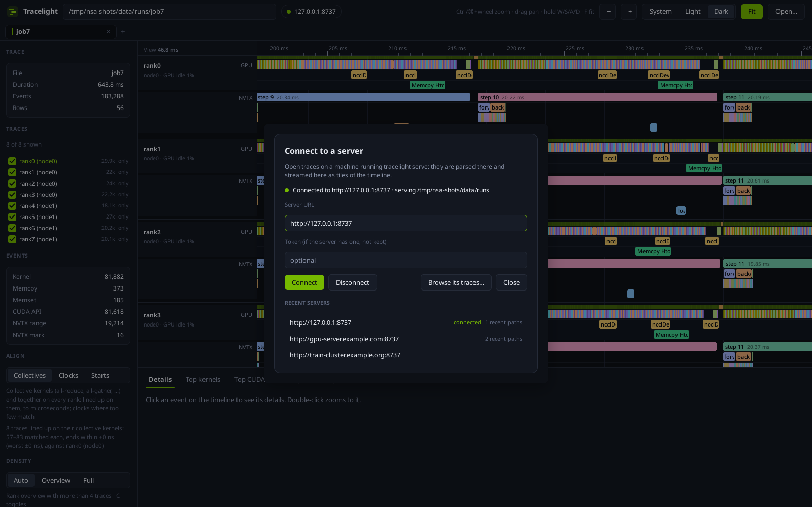

## traceshot: timeline screenshots from the command line (and for agents)

`traceshot` (`cmd/traceshot`) is a small, standalone CLI for when you want
a picture of part of a timeline, not an app. It is a static binary of about
11 MB for Linux (amd64, arm64) and macOS (arm64), with no display, browser,
cgo or nsys needed. It loads the same formats, lines the ranks up as the
viewer does, and draws a window of the timeline across the ranks you
choose into a PNG. The picture has a header, a time ruler, a block per rank
(every row, or with many ranks a busy/idle strip and one lane per kind of
row), and a legend of the GPU work that took the window's time.

Four subcommands help you find the window worth drawing:
- `info` lists the ranks, the top GPU work, and the ranges that repeat on
  every rank (usually the training steps).
- `find -name REGEX` lists matching events, each with a ready `-window`
  value.
- `gaps` lists the longest times a rank's GPUs sat idle.
- `imbalance` finds load imbalance between ranks. It matches each NCCL
  collective across the ranks and lists the ones they reached furthest
  apart. For each rank, it also says how often that rank came last and how
  late.

```sh
go build -o traceshot ./cmd/traceshot      # or: skills/trace-timeline-screenshot/build.sh
./traceshot info samples/ranks
./traceshot find -name '^step' -ranks 0 samples/ranks
./traceshot -layout summary -window 255ms+50ms -highlight '(?i)nccl' -o ranks.png samples/ranks
./traceshot -ranks 0-1 -around '^ProfilerStep' -nth 3 -o step.png samples/torch
./traceshot imbalance samples/ranks
./traceshot -imbalance 1 -layout summary -rows gpu -highlight '(?i)nccl' -o straggler.png samples/ranks
```

**Zoomed-in pictures for reports.** `-imbalance N` zooms onto the Nth
collective that `imbalance` lists, and annotates it:
- the header states the finding ("rank 7 started it 1.763 ms after
  rank 4");
- each rank's arrival is marked, and the wait between the first and the
  last rank is shaded;
- an **Arrivals** chart shows how late each rank was.

Any zoomed-in window also gets a **context strip** on top: every rank's
GPU busy line over a longer stretch, with the zoomed part boxed, so readers
see where it sits (`-context auto|on|off|A:B`).

Main flags:
- **What to load and draw:** `-ranks 0,4-7`; `-window A:B` or
  `-window A+DUR`; `-around REGEX -nth N` to frame an event;
  `-imbalance N` to zoom onto an imbalanced collective.
- **Layout:** `-layout rows|summary|auto`.
- **Rows:** `-rows gpu,nvtx,python,cpu,api`, `-match REGEX`,
  `-skip REGEX`.
- **Look:** `-highlight REGEX`, `-mark`, `-theme light|dark`, `-width`,
  `-scale`.

It prints the PNG's path and the exact window it drew, so you can refine
and draw again. Run `traceshot -h` for everything.

**For coding agents:**
[skills/trace-timeline-screenshot/SKILL.md](skills/trace-timeline-screenshot/SKILL.md)
is a ready-made skill. It tells an agent how to build traceshot, survey a
trace, pick a window (a step, the slowest collective, a GPU stall, the
worst imbalance between ranks) and render it.

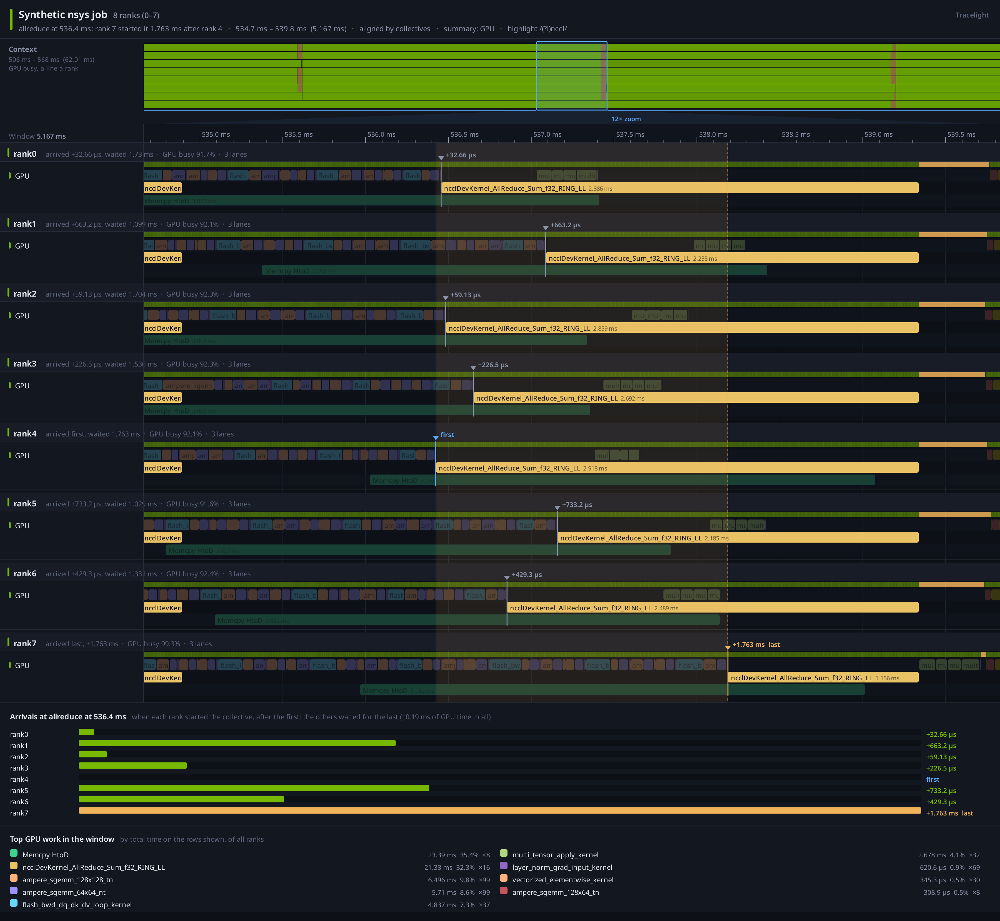

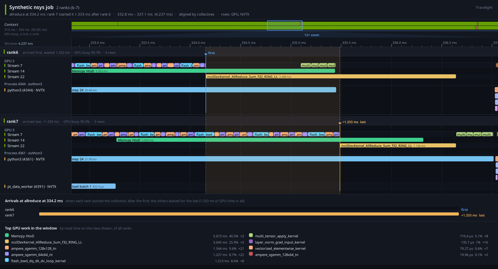

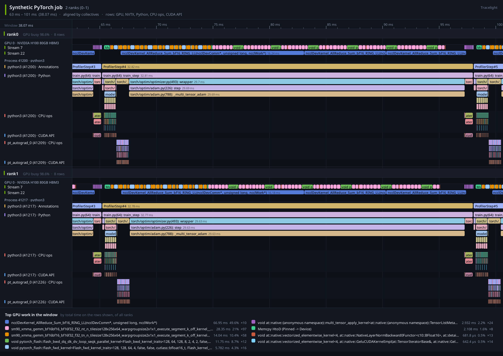

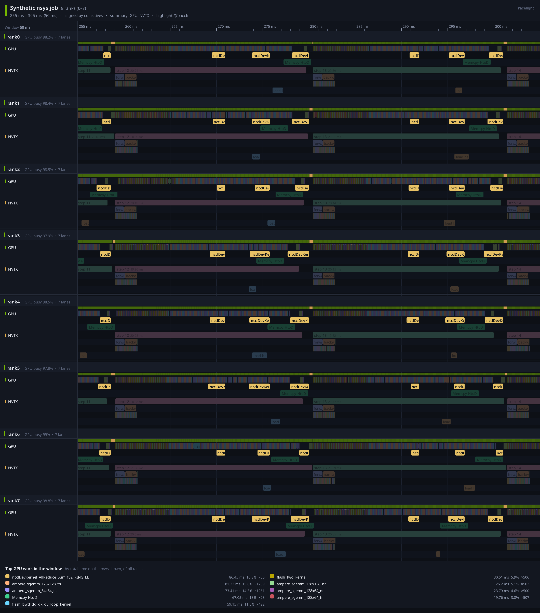

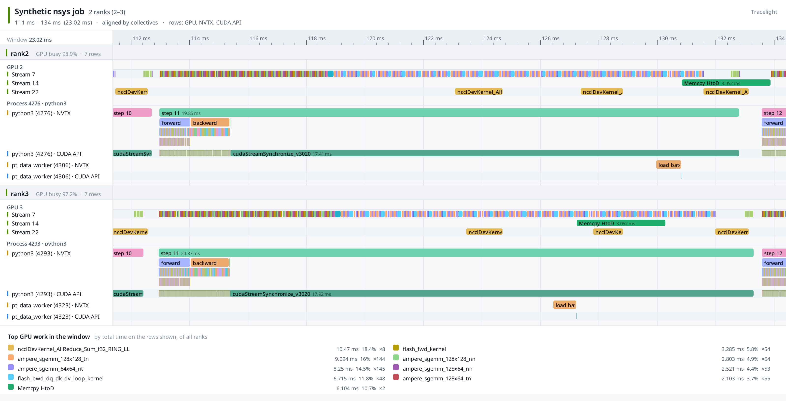

## Headless rendering, info and benchmarks

```sh
./tracelight --screenshot out.png samples/sample.sqlite               # the app's view, zoomed onto a kernel, selected
./tracelight --screenshot out.png -select=false samples/sample.sqlite # the whole trace
./tracelight --screenshot out.png -size 2560x1440 -scale 2 -theme light trace.sqlite
./tracelight --info trace.nsys-rep                                    # a text summary
./tracelight bench trace.sqlite                                       # load and frame times
```

`--screenshot` renders the app on the CPU with MyGo's in-memory renderer,
so it needs no display or GPU. `bench` times the load and about 850
scripted frames of zooming and panning. `bench -remote` times streaming
from a server with a simulated round trip. Results are in
[BENCHMARKS.md](BENCHMARKS.md).

| | Light | Dark |
|---|---|---|
| Desktop | 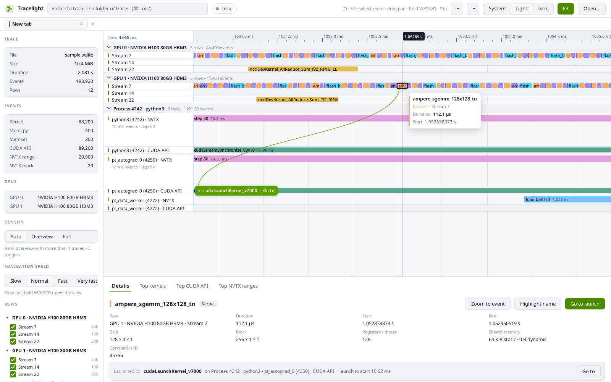 | 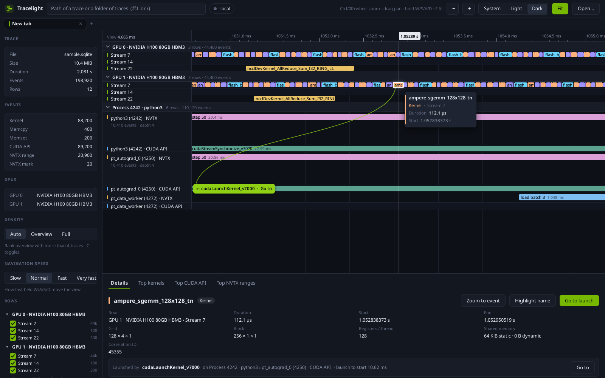 |
| Browser | 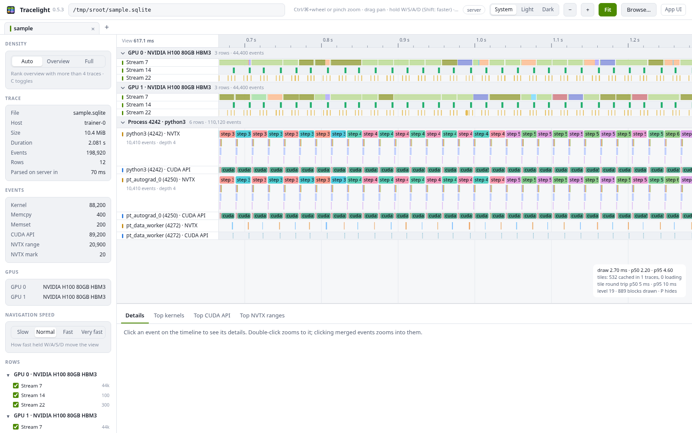 |  |

## Keyboard and mouse

| Input | Action |
|---|---|
| touchpad pinch; Ctrl/⌘ + wheel, or touchpad scroll with Ctrl/⌘ | zoom around the pointer (a pinch and touchpad scrolling follow the fingers at once; a wheel's notches zoom smoothly) |
| drag; wheel or two-finger scroll; Shift + wheel | pan in time and scroll the rows; scroll rows (sideways: pan); pan |
| hold W / S, A / D (Shift: 3× faster) | zoom in and out, pan, smoothly |
| + / −, 0 or Home, F | zoom a step; fit the trace; zoom to the selection |
| click, double-click | select an event; zoom to it |
| Shift + drag; Enter or Z | measure a range (summaries follow it); zoom to it |
| G | go to the linked event (a kernel's launch, an API call's kernel) |
| C | rank overview or full view |
| Ctrl/⌘ + L or `/`, Ctrl/⌘ + O, Ctrl/⌘ + K | path box, open, connect to a server |
| Ctrl/⌘ + T, Ctrl/⌘ + W, Ctrl + Tab, Ctrl/⌘ + 1…9 | new tab, close tab, next tab, nth tab (Alt + … in browsers) |
| Esc | clear the range and the selection |
| P | show the timeline's paint times |

## How it stays fast

- **Lanes.** Every row is split into lanes of events that don't overlap,
  sorted by start, so the visible events are found with two binary
  searches.
- **Level of detail per pixel column.** Events narrower than a pixel merge
  into blocks as opaque as they are dense. A prefix sum of durations gives
  each column's busy time. A frame costs O((columns + wide events) × log n)
  whatever the trace's size, and blocks don't flicker while panning.
- **Fast loading.** The `.nsys-rep` decoder is native. The SQLite reader
  calls modernc's C API directly, reading in parallel. The PyTorch reader
  streams.
- **Measured results.** A real 1.2M-event export loads in about 0.4 s and
  draws its first frame about 0.5 s after opening. While zooming from the
  whole trace down to microseconds, frames take 1.6 ms at the median and
  3.5 ms at p95. Details are in [BENCHMARKS.md](BENCHMARKS.md).

## Development

```
main.go, serve.go, bench*.go   the tracelight command: window, serve, bench, --screenshot, --info
cmd/traceshot/                 timeline PNGs from the command line (skills/trace-timeline-screenshot/)
cmd/gensample/, cmd/gentorch/  synthetic nsys and PyTorch traces
cmd/webui/, cmd/genwebui/      the App UI (WebAssembly) and its build
internal/trace/                the model, OpenWith (the one entry point for every format), SQLite and PyTorch readers, LOD, summaries
internal/nsysrep/              the native .nsys-rep decoder (FORMAT_NOTES.md)
internal/align/                lining up a session's traces (clocks, collectives)
internal/viewer/               the app's UI: timeline, sidebar, panels, sessions, connecting
internal/theme/                the look every renderer shares (palette, metrics, event colors)
internal/server/               the HTTP server, tiles, the classic web client (web/) and the App UI (webui/)
internal/remote/               the desktop app's client of the server
scripts/                       headless-Chrome checks and benchmarks of the browser clients
third_party/mygo/              two rendering patches applied to the App UI build only
```

```sh
go test ./...                      # everything; tests needing real traces skip without them
go generate ./internal/server      # rebuild the App UI after changing the viewer (a test checks it is current)
go run ./cmd/genicon               # re-render the icons from assets/icon.svg
```

The tests cover several areas:
- Parsers, on small generated databases, including malformed ones.
- LOD, against brute force.
- The UI, driven headlessly.
- Server confinement and tokens.
- A conformance test that keeps the desktop and browser renderers in step.
  Design notes for that are in [DESIGN.md](DESIGN.md).

To also run the end-to-end tests on a real trace of your own, set
`TRACELIGHT_TRACE` (an nsys SQLite export) and `TRACELIGHT_REPORT` (its
`.nsys-rep`). The screenshot tests write their pictures when
`TRACELIGHT_SHOTS` names a directory.

## Limitations

- Not shown yet from nsys reports: OS runtime calls, CPU sampling, GPU
  metrics, CUDA graphs as nodes, NCCL/MPI tables.
- Not shown yet from PyTorch traces: GPU-side annotations, memory and
  counter events, Python arguments.
- No search by name, minimap or saved views yet.
- The desktop app doesn't reopen its tabs at the next start.

## License

Tracelight is released under the [MIT License](LICENSE). The patched MyGo
files in [third_party/mygo](third_party/mygo) keep MyGo's own MIT license
([third_party/mygo/LICENSE](third_party/mygo/LICENSE)), and the Go modules
it depends on keep theirs.

---

Tracelight is an independent project, not affiliated with or endorsed by
NVIDIA. NVIDIA and Nsight are trademarks of NVIDIA Corporation. PyTorch is
a trademark of the Linux Foundation.
